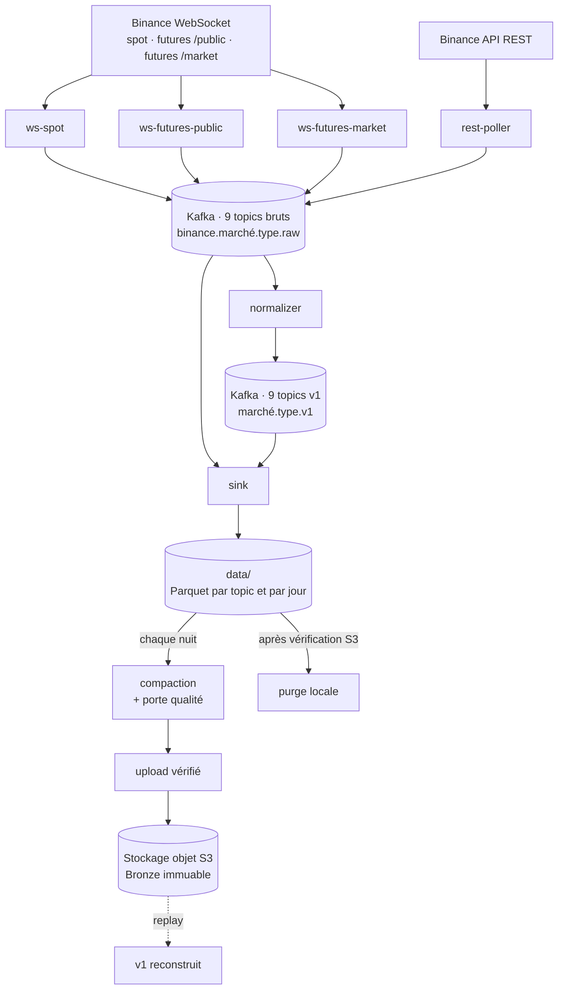
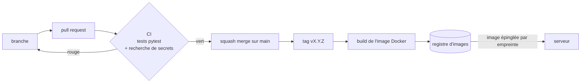

# big_data_architect

Plateforme de collecte de données de marché crypto en temps réel, centrée sur le BTC, pour la recherche quantitative en microstructure de marché.

Le pipeline reçoit en continu les flux de Binance (spot et futures perpétuels), les stocke tels quels dans Kafka, les convertit vers un contrat de données neutre, puis écrit le tout en fichiers Parquet. Chaque nuit, les données brutes de la veille sont compactées, contrôlées, puis archivées dans un stockage objet S3 immuable. Seul le dossier `exchanges/binance/` connaît Binance : le reste du code ne dépend d'aucune plateforme.

## Architecture



Le projet suit une architecture **Lambda** :

| Couche | Contenu | Rôle |
| --- | --- | --- |
| Chaude (vitesse) | Kafka + Parquet des 7 derniers jours sur le serveur | features en direct, entraînement du soir, débogage |
| Froide (batch) | Bronze dans S3 : les messages bruts de l'exchange, compactés, un fichier par topic et par jour | historique complet, source de vérité, backtests |

Seul le Bronze (topics bruts) est archivé. Le v1 n'est pas sauvegardé : il se reconstruit à l'identique depuis le Bronze avec `processing/replay.py`. Les couches Silver et Gold seront construites plus tard à partir du Bronze.

## Processus

Six processus Python tournent en continu, chacun dans son conteneur, et ne communiquent qu'à travers Kafka :

| Processus | Rôle | Commande |
| --- | --- | --- |
| `ws-spot` | Flux WebSocket spot | `python -m ingestion.run_ws spot` |
| `ws-futures-public` | Carnet d'ordres futures | `python -m ingestion.run_ws futures-public` |
| `ws-futures-market` | Trades, mark price et liquidations futures | `python -m ingestion.run_ws futures-market` |
| `rest-poller` | Open interest et snapshots du carnet, par API REST | `python -m ingestion.run_rest` |
| `normalizer` | Topics bruts → contrat neutre v1 | `python -m processing.run_normalize` |
| `sink` | Tous les topics → fichiers Parquet | `python -m storage.sink` |

Trois tâches planifiées tournent chaque nuit sur le serveur, dans cet ordre :

| Tâche | Rôle |
| --- | --- |
| Compaction | Regroupe les fichiers bruts de la veille (environ 2 350 par topic) en un seul fichier par topic, puis supprime les fichiers d'origine seulement si la porte qualité confirme que le contenu est identique |
| Upload | Copie vers S3 les jours compactés et complets, puis compare les empreintes des deux côtés |
| Purge locale | Supprime du serveur les jours de plus de 7 jours, seulement s'ils sont présents et identiques dans S3 |

Chaque tâche signale son début, sa fin et son code de sortie à un service de surveillance externe, qui alerte en cas d'échec ou d'absence d'exécution.

## Données collectées

| Flux Binance | Processus | Topic brut | Topic v1 |
| --- | --- | --- | --- |
| `kline_1m` (spot) | `ws-spot` | `binance.spot.kline.raw` | `spot.kline.v1` |
| `aggTrade` (spot) | `ws-spot` | `binance.spot.trade.raw` | `spot.trade.v1` |
| `aggTrade` (futures) | `ws-futures-market` | `binance.futures.trade.raw` | `futures.trade.v1` |
| `markPrice@1s` | `ws-futures-market` | `binance.futures.markprice.raw` | `futures.markprice.v1` |
| `forceOrder` | `ws-futures-market` | `binance.futures.liquidation.raw` | `futures.liquidation.v1` |
| `bookTicker` | `ws-futures-public` | `binance.futures.booktop.raw` | `futures.booktop.v1` |
| `depth@100ms` | `ws-futures-public` | `binance.futures.depth.raw` | `futures.depth.v1` |
| REST `openInterest`, toutes les 10 s | `rest-poller` | `binance.futures.open-interest.raw` | `futures.open-interest.v1` |
| REST `depth`, toutes les 5 min | `rest-poller` | `binance.futures.depth-snapshot.raw` | `futures.depth-snapshot.v1` |

Symbole suivi : `BTCUSDT`. Volume : environ 1,2 Go par jour de Bronze compacté.

## Structure du dépôt

```
big_data_architect/
├── common/                   code partagé : contrats, Kafka, backoff, arrêt propre, logs
├── exchanges/binance/        tout le savoir propre à Binance
├── ingestion/                WebSocket et REST → topics bruts
├── processing/               normalisation → topics v1, rejeu du Bronze
├── storage/                  topics → fichiers Parquet, compaction
├── quality/                  porte qualité et contrôles de continuité
├── deploy/                   scripts et unités systemd des tâches de nuit, surveillance
├── docs/runbooks/            procédures d'exploitation
├── tests/                    tests unitaires (pytest)
├── docker/                   docker-compose.yml (Kafka) et docker-compose.pipeline.yml (pipeline)
├── data/                     fichiers Parquet, non versionnés
├── 01 - doc/                 documents de cadrage
├── notebook/, sandbox/       essais
├── api/, chaos/, ml/, observability/, security/, streaming/
│                             réservés aux étapes suivantes
├── Dockerfile                image commune aux processus et à la compaction
├── requirements.txt          dépendances pour le développement local
└── requirements-pipeline.txt dépendances de l'image Docker
```

| Dossier | Fichiers principaux |
| --- | --- |
| `common/` | `events.py`, `contracts.py`, `errors.py`, `topics.txt`, `kafka_config.py`, `kafka_publisher.py`, `kafka_reader.py`, `backoff.py`, `shutdown.py`, `logging_setup.py` |
| `exchanges/binance/` | `adapter.py`, `streams.py`, `rest_client.py`, `normalize.py`, `controles.py` |
| `ingestion/` | `config.py`, `adapter.py`, `stream_callbacks.py`, `routing.py`, `rest_poller.py`, `run_ws.py`, `run_rest.py` |
| `processing/` | `normalizer.py`, `run_normalize.py`, `replay.py` |
| `storage/` | `parquet_writer.py`, `sink.py`, `compaction.py`, `run_compaction.py` |
| `quality/` | `porte.py`, `continuite.py`, `inventaire.py`, `comparaison.py` |
| `deploy/` | `compaction/`, `upload/`, `purge/`, `monitoring/` |

## Prérequis

- Docker et Docker Compose v2
- Python 3.12 pour le développement local
- Sous Windows : WSL

## Démarrage en local

Depuis `docker/`, une seule fois, pour ne pas avoir à préciser les deux fichiers compose :

```bash
echo "COMPOSE_FILE=docker-compose.yml:docker-compose.pipeline.yml" > .env
```

Puis :

```bash
docker compose up -d --build   # Kafka, kafka-ui, création des topics, puis les 6 processus
docker compose ps              # kafka-init « Exited (0) », les autres « Up »
docker compose down            # arrêt ; les topics et data/ sont conservés
docker compose down -v         # arrêt et suppression des topics ; data/ est conservé
```

Pour démarrer Kafka seul, sans le pipeline : `docker compose -f docker-compose.yml up -d`.

| Service | Adresse |
| --- | --- |
| kafka-ui | http://localhost:8080 |
| Kafka depuis ta machine | `localhost:9092` |
| Kafka depuis un conteneur | `kafka:29092` |

Les processus du pipeline ne publient aucun port. Les tâches de nuit (compaction, upload, purge) ne tournent que sur le serveur de production.

## Vérifier que tout fonctionne

```bash
docker logs ws-futures-market --tail 5    # « Connexion établie (binance) »
docker logs sink --tail 5                 # « N lignes écrites dans M fichiers », environ une fois par minute

docker exec kafka kafka-console-consumer --bootstrap-server localhost:9092 \
  --topic futures.trade.v1 --max-messages 2

du -sh data                               # depuis la racine du dépôt
```

Rangement des fichiers Parquet, par topic et par jour :
- jour en cours : `data/<topic>/date=AAAA-MM-JJ/part-<id>.parquet`, un fichier par minute ;
- jour compacté (topics bruts) : `data/<topic>/date=AAAA-MM-JJ/compacte-AAAA-MM-JJ.parquet`.

Le même rangement est utilisé dans S3, ce qui permet de lire l'archive directement avec DuckDB.

## Développement local

```bash
python3 -m venv .venv
source .venv/bin/activate
pip install -r requirements.txt
python3 -m pytest -q
```

Avec Kafka démarré, un processus peut aussi se lancer à la main depuis la racine, par exemple `python3 -m ingestion.run_ws spot`. Ne lance pas à la main un processus qui tourne déjà dans Docker : chaque message serait reçu deux fois.

Les tests ne demandent ni Kafka, ni accès à Binance, ni stockage S3 : chaque dépendance externe est remplacée par un faux objet qui respecte le même contrat. Ils couvrent le découpage des messages Binance, les normalisations, l'aiguillage vers les topics, le classement des erreurs REST, la planification des requêtes, l'écriture Parquet, le rejeu, la compaction, la porte qualité et les contrôles de continuité.


## Chaîne de livraison



- `main` est protégée : on n'y pousse jamais directement, tout passe par une pull request avec une CI verte.
- Une release se déclenche en poussant un tag `vX.Y.Z`. L'image est construite par la CI, jamais à la main.
- Le serveur utilise l'image par son empreinte (`@sha256:…`), pas par son tag : une image modifiée après coup ne serait pas exécutée.


## Qualité des données

La compaction passe par une **porte qualité** avant de supprimer quoi que ce soit :
- **Bloquant** : le fichier compacté doit contenir exactement les mêmes lignes que les fichiers d'origine (mêmes colonnes, même nombre de lignes, même empreinte). Sinon, rien n'est supprimé et la tâche échoue.
- **Non bloquant** : doublons, trades manquants (trous dans les identifiants) et ruptures de séquence du carnet d'ordres sont signalés, mais la donnée est quand même archivée. Une donnée avec un trou reste plus utile qu'aucune donnée.

Les contrôles propres à Binance sont déclarés dans `exchanges/binance/controles.py` et injectés dans la porte, sur le même modèle que les normalisations.

## Configuration

| Paramètre | Où | Valeur par défaut |
| --- | --- | --- |
| Adresse de Kafka | variable `KAFKA_BOOTSTRAP_SERVERS` | `localhost:9092`, et `kafka:29092` dans Docker |
| Dossier des fichiers Parquet | variable `DATA_DIR` | `data`, et `/data` dans Docker |
| Liste des topics | `common/topics.txt` | 18 topics |
| Flux et requêtes REST | `exchanges/binance/streams.py` | voir « Données collectées » |
| Fréquence d'écriture Parquet | `storage/parquet_writer.py` | toutes les 60 s ou toutes les 50 000 lignes |
| Jours gardés sur le serveur | variable `JOURS_LOCAL` de la purge | 7 |

`common/topics.txt` est la seule liste des topics : `kafka-init` la lit pour les créer, et le code Python la lit pour refuser tout topic absent. L'auto-création de topics est désactivée sur le broker.

Les secrets (clés S3, adresses de surveillance) ne sont jamais dans le dépôt ni dans l'image Docker : ils sont fournis au serveur par des fichiers de configuration locaux, lisibles par root uniquement.

## Conventions

**Topics**
- Brut : `<exchange>.<marché>.<type>.raw`, qui contient le message de l'exchange intact, dans une enveloppe `exchange`, `market`, `kind`, `symbol`, `received_at`, `payload`.
- Neutre : `<marché>.<type>.v1`, qui suit le contrat défini dans `common/contracts.py`. Un changement de format crée une `v2`, sans modifier la `v1`.
- Clé Kafka : le symbole, pour garder l'ordre des messages par symbole.

**Contrat v1**
- Prix et quantités en texte décimal : aucun arrondi avant le calcul.
- Horodatages en millisecondes UTC.
- Un champ que l'exchange ne fournit pas vaut `null`.

**Rangement par jour**
- Bronze : rangé par heure de réception (`received_at`).
- v1 : rangé par heure de l'événement côté exchange.

**Livraison**
- Le normaliseur et le sink valident leur lecture seulement après avoir publié ou écrit le résultat : un crash ne perd aucun message.
- En contrepartie, quelques doublons sont possibles. Chaque record garde l'identifiant de Binance (`trade_id`, numéros de séquence du carnet, horodatage d'événement) pour les retirer à la lecture.

## Sécurité (principes)

La plateforme est conçue pour être attaquée lors d'une phase de pentest. Les principes appliqués :
- **Moindre privilège** : les conteneurs tournent sans root ; les tâches de nuit tournent sous des comptes dédiés, avec un système de fichiers en lecture seule sauf le strict nécessaire ; la compaction tourne sans accès réseau.
- **Archive immuable** : les objets S3 sont verrouillés en écriture unique (WORM) dès leur dépôt. La clé utilisée par le serveur peut déposer et lire, mais pas supprimer.
- **Secrets hors du code** : aucun secret dans Git ni dans l'image ; recherche automatique de secrets dans la CI.
- **Vérifier avant de supprimer** : aucune donnée locale n'est supprimée sans preuve qu'une copie identique existe ailleurs.
- **Observable** : chaque tâche signale ses succès et ses échecs à une surveillance externe.

Pour signaler une vulnérabilité, ne pas ouvrir d'issue publique : contacter le mainteneur directement.

## Ajouter un flux

1. Ajouter le flux à un groupe dans `exchanges/binance/streams.py`.
2. Lui associer un type neutre dans `KINDS`, dans `exchanges/binance/adapter.py`.
3. Écrire sa normalisation et l'ajouter à `NORMALIZERS`, dans `exchanges/binance/normalize.py`, avec son type dans `common/contracts.py`.
4. Déclarer ses topics brut et v1 dans `common/topics.txt`.
5. `python3 -m pytest -q` : un test échoue si l'un de ces éléments manque.

## Ajouter un exchange

1. Créer `exchanges/<nom>/` avec `adapter.py`, `streams.py`, `rest_client.py`, `normalize.py` et `controles.py`, sur le modèle de Binance.
2. Déclarer ses topics bruts dans `common/topics.txt`.
3. Remplacer les imports `exchanges.binance` dans `ingestion/run_ws.py`, `ingestion/run_rest.py`, `processing/run_normalize.py` et `storage/run_compaction.py`.

`common/`, `storage/`, `quality/`, les topics v1 et tout ce qui les lit restent inchangés.

## État actuel

Le pipeline tourne en continu sur un serveur dédié : 3 connexions WebSocket, l'interrogation REST, la normalisation et l'écriture Parquet, soit de l'ordre de 20 000 à 30 000 lignes par minute. Chaque nuit, le Bronze de la veille est compacté, contrôlé, archivé dans S3 puis vérifié, et le serveur ne garde que les 7 derniers jours. Une restauration depuis S3 a été testée : le fichier rapatrié est identique à l'octet près.

Limites connues :
- **Coupures Binance** : Binance ferme chaque connexion WebSocket au bout de 24 h. La reconnexion est automatique, mais elle laisse un court trou, signalé par la porte qualité. Les trades manquants pourront être rattrapés depuis les archives publiques de Binance.
- **Liquidations** : Binance ne diffuse qu'une liquidation par seconde au maximum ; le flux est un indicateur, pas un relevé complet.
- **Kafka** : un seul broker, sans réplication. Une panne du serveur interrompt la collecte.
- **v1** : non compacté et non archivé ; au-delà de 7 jours, il se reconstruit depuis le Bronze.

La suite est planifiée : preuve de reconstruction complète du v1 depuis S3, chaos engineering (pannes simulées), pentest de l'infrastructure, puis recherche quantitative.