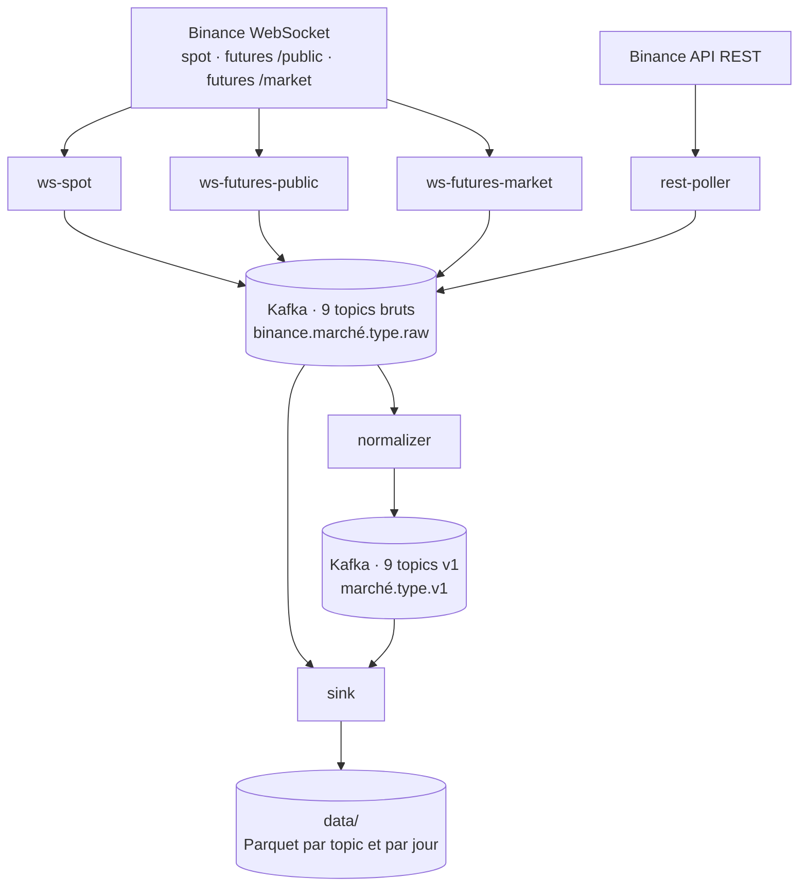

# big_data_architect

Plateforme de collecte de données de marché crypto en temps réel, centrée sur le BTC, pour la recherche quantitative en microstructure de marché.

Le pipeline reçoit en continu les flux de Binance (spot et futures perpétuels), les stocke tels quels dans Kafka, les convertit vers un contrat de données neutre, puis écrit le tout en fichiers Parquet. Seul le dossier `exchanges/binance/` connaît Binance : le reste du code ne dépend d'aucune plateforme.

## Architecture



Six processus Python, chacun dans son conteneur, qui ne communiquent qu'à travers Kafka :

| Processus | Rôle | Commande |
| --- | --- | --- |
| `ws-spot` | Flux WebSocket spot | `python -m ingestion.run_ws spot` |
| `ws-futures-public` | Carnet d'ordres futures | `python -m ingestion.run_ws futures-public` |
| `ws-futures-market` | Trades, mark price et liquidations futures | `python -m ingestion.run_ws futures-market` |
| `rest-poller` | Open interest et snapshots du carnet, par API REST | `python -m ingestion.run_rest` |
| `normalizer` | Topics bruts → contrat neutre v1 | `python -m processing.run_normalize` |
| `sink` | Tous les topics → fichiers Parquet | `python -m storage.sink` |

## Données collectées

| Flux Binance | Processus | Topic brut | Topic v1 |
| --- | --- | --- | --- |
| `kline_1m` (spot) | `ws-spot` | `binance.spot.kline.raw` | `spot.kline.v1` |
| `aggTrade` (spot) | `ws-spot` | `binance.spot.trade.raw` | `spot.trade.v1` |
| `aggTrade` (futures) | `ws-futures-market` | `binance.futures.trade.raw` | `futures.trade.v1` |
| `markPrice@1s` | `ws-futures-market` | `binance.futures.markprice.raw` | `futures.markprice.v1` |
| `forceOrder` | `ws-futures-market` | `binance.futures.liquidation.raw` | `futures.liquidation.v1` |
| `bookTicker` | `ws-futures-public` | `binance.futures.booktop.raw` | `futures.booktop.v1` |
| `depth@100ms` | `ws-futures-public` | `binance.futures.depth.raw` | `futures.depth.v1` |
| REST `openInterest`, toutes les 10 s | `rest-poller` | `binance.futures.open-interest.raw` | `futures.open-interest.v1` |
| REST `depth`, toutes les 5 min | `rest-poller` | `binance.futures.depth-snapshot.raw` | `futures.depth-snapshot.v1` |

Symbole suivi : `BTCUSDT`.

## Structure du dépôt

```
big_data_architect/
├── common/                   code partagé : contrats, Kafka, backoff, arrêt propre, logs
├── exchanges/binance/        tout le savoir propre à Binance
├── ingestion/                WebSocket et REST → topics bruts
├── processing/               normalisation → topics v1
├── storage/                  topics → fichiers Parquet
├── tests/                    tests unitaires (pytest)
├── docker/                   docker-compose.yml (Kafka) et docker-compose.pipeline.yml (pipeline)
├── data/                     fichiers Parquet, non versionnés
├── 01 - doc/                 documents de cadrage
├── notebook/, sandbox/       essais
├── api/, chaos/, ml/, observability/, security/, streaming/
│                             réservés aux étapes suivantes, vides pour l'instant
├── Dockerfile                image commune aux 6 processus
├── requirements.txt          dépendances pour le développement local
└── requirements-pipeline.txt dépendances de l'image Docker
```

| Dossier | Fichiers principaux |
| --- | --- |
| `common/` | `events.py`, `contracts.py`, `errors.py`, `topics.txt`, `kafka_config.py`, `kafka_publisher.py`, `kafka_reader.py`, `backoff.py`, `shutdown.py`, `logging_setup.py` |
| `exchanges/binance/` | `adapter.py`, `streams.py`, `rest_client.py`, `normalize.py` |
| `ingestion/` | `config.py`, `adapter.py`, `stream_callbacks.py`, `routing.py`, `rest_poller.py`, `run_ws.py`, `run_rest.py` |
| `processing/` | `normalizer.py`, `run_normalize.py` |
| `storage/` | `parquet_writer.py`, `sink.py` |

## Prérequis

- Docker et Docker Compose v2
- Python 3.12 pour le développement local
- Sous Windows : WSL

## Démarrage

Depuis `docker/`, une seule fois, pour ne pas avoir à préciser les deux fichiers compose :

```bash
echo "COMPOSE_FILE=docker-compose.yml:docker-compose.pipeline.yml" > .env
```

Puis :

```bash
docker compose up -d --build   # Kafka, kafka-ui, création des topics, puis les 6 processus
docker compose ps              # kafka-init « Exited (0) », les autres « Up »
docker compose down            # arrêt ; les topics et data/ sont conservés
docker compose down -v         # arrêt et suppression des topics ; data/ est conservé
```

Pour démarrer Kafka seul, sans le pipeline : `docker compose -f docker-compose.yml up -d`.

| Service | Adresse |
| --- | --- |
| kafka-ui | http://localhost:8080 |
| Kafka depuis ta machine | `localhost:9092` |
| Kafka depuis un conteneur | `kafka:29092` |

Les processus du pipeline ne publient aucun port.

## Vérifier que tout fonctionne

```bash
docker logs ws-futures-market --tail 5    # « Connexion établie (binance) »
docker logs sink --tail 5                 # « N lignes écrites dans M fichiers », environ une fois par minute

docker exec kafka kafka-console-consumer --bootstrap-server localhost:9092 \
  --topic futures.trade.v1 --max-messages 2

du -sh data                               # depuis la racine du dépôt
```

Les fichiers Parquet sont rangés par topic et par jour : `data/<topic>/date=AAAA-MM-JJ/part-<id>.parquet`.

## Développement local

```bash
python3 -m venv .venv
source .venv/bin/activate
pip install -r requirements.txt
python3 -m pytest -q
```

Avec Kafka démarré, un processus peut aussi se lancer à la main depuis la racine, par exemple `python3 -m ingestion.run_ws spot`. Ne lance pas à la main un processus qui tourne déjà dans Docker : chaque message serait reçu deux fois.

Les tests ne demandent ni Kafka ni accès à Binance : chaque dépendance externe est remplacée par un faux objet qui respecte le même contrat. Ils couvrent le découpage des messages Binance, les 8 normalisations, l'aiguillage vers les topics, le classement des erreurs REST, la planification des requêtes, l'écriture Parquet et la cohérence entre flux, topics et normalisations.

## Configuration

| Paramètre | Où | Valeur par défaut |
| --- | --- | --- |
| Adresse de Kafka | variable `KAFKA_BOOTSTRAP_SERVERS` | `localhost:9092`, et `kafka:29092` dans Docker |
| Dossier des fichiers Parquet | variable `DATA_DIR` | `data`, et `/data` dans Docker |
| Liste des topics | `common/topics.txt` | 18 topics |
| Flux et requêtes REST | `exchanges/binance/streams.py` | voir « Données collectées » |
| Fréquence d'écriture Parquet | `storage/parquet_writer.py` | toutes les 60 s ou toutes les 50 000 lignes |

`common/topics.txt` est la seule liste des topics : `kafka-init` la lit pour les créer, et le code Python la lit pour refuser tout topic absent. L'auto-création de topics est désactivée sur le broker.

## Conventions

**Topics**
- Brut : `<exchange>.<marché>.<type>.raw`, qui contient le message de l'exchange intact, dans une enveloppe `exchange`, `market`, `kind`, `symbol`, `received_at`, `payload`.
- Neutre : `<marché>.<type>.v1`, qui suit le contrat défini dans `common/contracts.py`. Un changement de format crée une `v2`, sans modifier la `v1`.
- Clé Kafka : le symbole, pour garder l'ordre des messages par symbole.

**Contrat v1**
- Prix et quantités en texte décimal : aucun arrondi avant le calcul.
- Horodatages en millisecondes UTC.
- Un champ que l'exchange ne fournit pas vaut `null`.

**Livraison**
- Le normaliseur et le sink valident leur lecture seulement après avoir publié ou écrit le résultat : un crash ne perd aucun message.
- En contrepartie, quelques doublons sont possibles. Chaque record garde l'identifiant de Binance (`trade_id`, numéros de séquence du carnet, horodatage d'événement) pour les retirer à la lecture.

## Ajouter un flux

1. Ajouter le flux à un groupe dans `exchanges/binance/streams.py`.
2. Lui associer un type neutre dans `KINDS`, dans `exchanges/binance/adapter.py`.
3. Écrire sa normalisation et l'ajouter à `NORMALIZERS`, dans `exchanges/binance/normalize.py`, avec son type dans `common/contracts.py`.
4. Déclarer ses topics brut et v1 dans `common/topics.txt`.
5. `python3 -m pytest -q` : un test échoue si l'un de ces éléments manque.

## Ajouter un exchange

1. Créer `exchanges/<nom>/` avec `adapter.py`, `streams.py`, `rest_client.py` et `normalize.py`, sur le modèle de Binance.
2. Déclarer ses topics bruts dans `common/topics.txt`.
3. Remplacer les imports `exchanges.binance` dans `ingestion/run_ws.py`, `ingestion/run_rest.py` et `processing/run_normalize.py`.

`common/`, `storage/`, les topics v1 et tout ce qui les lit restent inchangés.

## État actuel

Le pipeline fonctionne de bout en bout en local : 3 connexions WebSocket, l'interrogation REST, la normalisation et l'écriture Parquet, soit de l'ordre de 20 000 à 30 000 lignes par minute.

Limites connues :
- **Collecte locale** : la collecte s'arrête quand la machine s'éteint, et les données manquées ne sont pas rattrapées.
- **Coupures Binance** : Binance ferme chaque connexion WebSocket au bout de 24 h. La reconnexion est automatique, mais elle laisse un court trou.
- **Liquidations** : Binance ne diffuse qu'une liquidation par seconde au maximum ; le flux est un indicateur, pas un relevé complet.
- **Kafka** : un seul broker, sans réplication ni chiffrement ni authentification. Cette configuration est réservée à un usage local.
- **Fichiers Parquet** : un fichier par topic et par minute, sans compaction pour l'instant.

La suite est planifiée : qualité des données, monitoring, collecte continue sur un serveur, puis recherche quantitative.