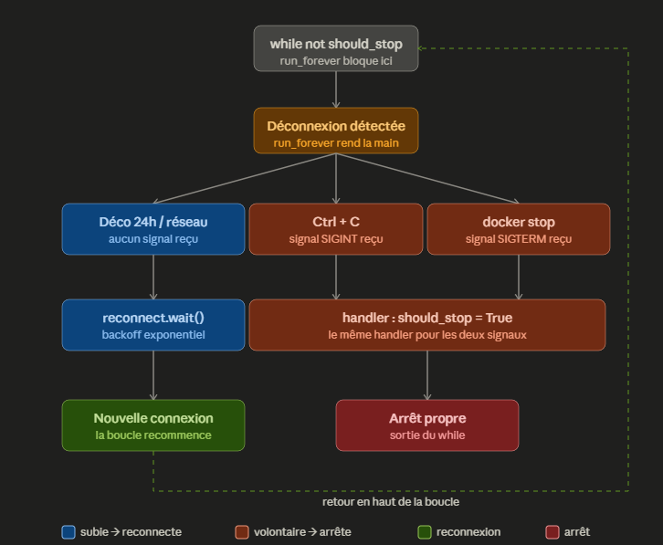

# Ingestion — Consumer Binance → Kafka

Module d'ingestion temps réel des données de marché Binance.
Première brique du pipeline BigData Finance : il se connecte au flux
WebSocket public de Binance, reçoit les bougies (klines) en continu,
les transforme dans un format stable et les publie dans le topic Kafka
`klines.raw`.

---

## Vue d'ensemble

```
Binance WebSocket ──texte──▶ on_message ──▶ transform_kline ──dict──▶ KafkaPublisher ──▶ topic klines.raw
                             (callbacks)     (transform)              (on_record)
```

Le consumer est conçu pour tourner en continu : il se reconnecte
automatiquement en cas de coupure et s'arrête proprement sur demande,
en livrant les derniers messages à Kafka avant de quitter.

Aucune clé API n'est nécessaire : les flux de données de marché Binance
sont publics.

---

## Qu'est-ce qu'une kline ?

Une **kline** (contraction de *candlestick line*) est une bougie de
chandelier japonais représentant l'activité de marché sur un intervalle
de temps donné (ici 1 minute). Elle contient les valeurs **OHLCV** :

| Champ | Signification |
|-------|---------------|
| O (Open)   | Prix d'ouverture de l'intervalle |
| H (High)   | Prix le plus haut atteint |
| L (Low)    | Prix le plus bas atteint |
| C (Close)  | Prix de clôture de l'intervalle |
| V (Volume) | Volume échangé pendant l'intervalle |

Le champ `x` (`is_closed` après transformation) indique si la bougie est
**fermée** :

- `false` → bougie en cours de formation, ses valeurs évoluent encore.
  Binance envoie une mise à jour toutes les ~2 secondes.
- `true` → bougie fermée et définitive. Envoyée une seule fois, à la fin
  de la minute. La bougie suivante s'ouvre au prix de clôture de
  celle-ci.

**Comportement actuel :** toutes les mises à jour sont publiées dans
Kafka (environ 30 par minute et par symbole, dont une seule fermée).
Le filtrage sur `is_closed` est une décision ouverte (voir
« Prochaines étapes »).

---

## Architecture des fichiers

Le module suit le principe de **responsabilité unique** : chaque fichier
fait une seule chose et ne change que pour une seule raison.

```
ingestion/
├── config.py              # paramètres de connexion (dataclass immuable)
├── callbacks.py           # réactions aux événements WebSocket
├── transform.py           # format Binance brut → format de sortie
├── kafka_publisher.py     # publication des records dans Kafka
├── reconnect.py           # logique de backoff exponentiel
├── shutdown.py            # arrêt propre via signaux système
├── validation.py          # contrôle de structure des messages (pas encore branché)
└── binance_consumer.py    # point d'entrée — assemble et lance
```

| Fichier | Type | Responsabilité | Change si… |
|---------|------|----------------|------------|
| `config.py` | `@dataclass(frozen=True)` | Regroupe les paramètres fixes et construit l'URL | on change de paire, d'intervalle, d'endpoint |
| `callbacks.py` | classe | Réagit aux événements WebSocket, filtre et délègue | la gestion des événements WebSocket change |
| `transform.py` | fonction pure | Convertit un message Binance en record propre | Binance change son format |
| `validation.py` | fonctions pures | Vérifie qu'un message a la structure attendue d'une kline | le format attendu change |
| `kafka_publisher.py` | classe | Envoie les records dans Kafka | on change de broker ou de topic |
| `reconnect.py` | classe | Calcule et applique le délai de reconnexion | la stratégie de reconnexion change |
| `shutdown.py` | classe | Capte les signaux d'arrêt et ferme la connexion | la gestion de l'arrêt change |
| `binance_consumer.py` | script | Crée les objets, les branche, lance la boucle | l'assemblage change |

### Classe ou fonction ?

- **Classe** quand il y a un état qui persiste pendant l'exécution
  (connexion ouverte, compteur de tentatives, drapeau d'arrêt,
  producer Kafka et son tampon).
- **Fonction** quand on reçoit une entrée, renvoie une sortie et ne garde
  aucune mémoire (`transform_kline`).
- **Dataclass figée** quand ce sont des paramètres fixes regroupés.

---

## Le découplage par handler

`BinanceCallbacks` ne connaît pas Kafka. Elle reçoit à sa création une
fonction `on_record`, qu'elle appelle pour chaque kline transformée,
sans savoir ce que cette fonction fait.

```python
publisher = KafkaPublisher("localhost:9092", "klines.raw")
callbacks = BinanceCallbacks(reconnect=reconnect, on_record=publisher.publish)
```

`on_record` est typé `Callable[[dict], None]` : une fonction qui reçoit
un dict et ne renvoie rien.

**Pourquoi ce choix plutôt qu'un héritage** (une sous-classe
`KafkaBinanceCallbacks`, initialement envisagée) :

- la classe qui *reçoit* les données ne dépend pas de celle qui les
  *stocke* ;
- changer de destination (affichage, Kafka, fichier, faux handler de
  test) se fait en modifiant une seule ligne dans `binance_consumer.py` ;
- la partie Binance peut être testée sans lancer Kafka.

Le flux étant temps réel, il fonctionne en **push** : on ne récupère pas
les données après coup, on indique à l'avance quoi faire de chaque
record au moment où il arrive.

---

## Contrat de sortie

Chaque message publié dans `klines.raw` respecte ce format.

- **Clé** : le symbole (`BTCUSDT`). Une même clé va toujours dans la même
  partition, ce qui garantit l'ordre des messages par symbole.
- **Valeur** : un objet JSON (sérialisé avec `json.dumps`).

| Champ | Type | Source Binance | Description |
|-------|------|----------------|-------------|
| `symbol` | str | `s` | Paire de trading |
| `interval` | str | `k.i` | Intervalle de la bougie |
| `open` | float | `k.o` | Prix d'ouverture |
| `close` | float | `k.c` | Dernier prix / prix de clôture |
| `high` | float | `k.h` | Plus haut |
| `low` | float | `k.l` | Plus bas |
| `volume` | float | `k.v` | Volume échangé |
| `nb_trades` | int | `k.n` | Nombre de transactions |
| `is_closed` | bool | `k.x` | Bougie définitive ou non |
| `open_time` | int | `k.t` | Ouverture de la bougie (ms, epoch UTC) |
| `close_time` | int | `k.T` | Fermeture de la bougie (ms, epoch UTC) |
| `event_time` | int | `E` | Heure d'émission par Binance (ms, epoch UTC) |

Exemple :

```json
{"symbol": "BTCUSDT", "interval": "1m", "open": 85892.25, "close": 85926.01,
 "high": 85926.01, "low": 85892.01, "volume": 5.53415, "nb_trades": 1452,
 "is_closed": false, "open_time": 1791239880000, "close_time": 1791239939999,
 "event_time": 1791239932035}
```

L'identifiant unique d'une bougie est le couple **`symbol` + `open_time`**.
Toutes les mises à jour d'une même bougie partagent ces deux valeurs.

Ce contrat ne doit pas changer sans précaution : tout ce qui lit le topic
en aval en dépend. Changer de source (autre exchange) implique d'écrire
une nouvelle fonction de transformation qui produit **exactement** ce
format.

---

## Gestion des messages et des erreurs

Dans `on_message` :

| Cas | Comportement |
|-----|--------------|
| Message non-kline (ex. confirmation d'abonnement) | Ignoré, log `DEBUG` |
| JSON invalide ou champ manquant | Ignoré, log `WARNING` |
| Kline valide | Transformée puis transmise à `on_record` |

`validation.py` contient deux fonctions, `is_valid_kline` (structure du
message) et `is_closed_candle` (bougie fermée ou non), qui ne sont **pas
encore appelées** par `on_message`. La validation effective repose pour
l'instant sur le `try/except`.

Le bloc `try` ne protège que le parsing et la transformation. L'appel à
`on_record` est volontairement placé **hors** du `try` : une erreur côté
Kafka ne doit jamais être confondue avec un message Binance invalide.

---

## Publication Kafka

`KafkaPublisher` utilise `confluent-kafka` et suit trois temps :

| Méthode | Rôle |
|---------|------|
| `__init__` | Crée le `Producer` une seule fois (connexion via `bootstrap.servers`) |
| `publish` | Dépose le record dans le tampon local, puis `poll(0)` |
| `close` | `flush()` : attend que tous les messages en attente soient livrés |

Points clés :

- `produce()` est **asynchrone** : il dépose le message dans un tampon et
  rend la main immédiatement. L'envoi réel se fait par lots en
  arrière-plan.
- `poll(0)` traite les accusés de réception sans bloquer. Sans lui, la
  file d'accusés sature (`BufferError: Local: Queue full`).
- Chaque accusé déclenche `_on_delivery`, qui journalise les échecs de
  livraison.
- `close()` est appelé après la boucle principale : sans `flush()`, les
  derniers messages du tampon seraient perdus à l'arrêt.

---

## La logique de connexion résiliente

Le cœur du consumer est une boucle qui maintient la connexion vivante
en permanence.

```
while not should_stop:
    run_forever()          # bloque tant que la connexion est active
    if not should_stop:
        reconnect.wait()   # backoff avant de relancer
publisher.close()          # livre les messages restants
```

Deux niveaux distincts travaillent ensemble :

- **`run_forever()`** maintient **une** connexion vivante. Il rend la
  main dès que cette connexion se ferme.
- **La boucle `while`** décide s'il faut **relancer** une nouvelle
  connexion après que `run_forever()` a rendu la main.

Sans la boucle, le consumer mourrait à la première déconnexion.

---

## Les trois scénarios de fermeture



| Scénario | Signal reçu ? | Comportement |
|----------|---------------|--------------|
| Déconnexion 24h / réseau | Non | Reconnexion avec backoff |
| Ctrl+C (dev local) | SIGINT | Arrêt propre + flush Kafka |
| `docker stop` (prod) | SIGTERM | Arrêt propre + flush Kafka |

La distinction repose entièrement sur les **signaux système**, pas sur
les codes de fermeture WebSocket (peu fiables, notamment sur WSL).

- **Un signal reçu** = arrêt volontaire → on stoppe la boucle
- **Aucun signal** = déconnexion subie → on reconnecte

`SIGINT` et `SIGTERM` pointent vers le **même handler** qui met
`should_stop = True` et ferme la connexion pour interrompre
`run_forever()` immédiatement.

---

## Le backoff exponentiel

Pour éviter le bannissement IP de Binance (limite de 300 connexions par
5 minutes), le délai entre deux tentatives de reconnexion **double** à
chaque échec, jusqu'à un plafond.

```
délai = min(2 ^ tentative, max_delay)
```

| Tentative | Délai |
|-----------|-------|
| 0 | 1 s |
| 1 | 2 s |
| 2 | 4 s |
| 3 | 8 s |
| ... | ... |
| 6+ | 60 s (plafond) |

Le compteur est **remis à zéro** dès qu'une connexion réussit
(`on_open` appelle `reconnect.reset()`). Une connexion stable repart
donc toujours d'un délai minimal.

---

## Limites Binance respectées

| Limite | Valeur | Gérée par |
|--------|--------|-----------|
| Connexions | 300 / 5 min / IP | Backoff exponentiel |
| Messages entrants | 5 / seconde | N/A (on ne fait qu'écouter) |
| Streams par connexion | 1024 max | 1 seul stream utilisé |
| Durée connexion | 24h max | Reconnexion automatique |

Le ping/pong est géré automatiquement par `websocket-client` : Binance
envoie un ping toutes les 20 secondes, la librairie répond seule.

---

## Lancer le pipeline

**1. Démarrer l'infrastructure Kafka** (depuis le dossier `docker/`) :

```bash
cd docker
docker compose up -d
docker compose ps        # kafka doit être "healthy"
```

**2. Installer les dépendances et lancer le consumer** (depuis `ingestion/`) :

```bash
pip install -r requirements.txt
python3 binance_consumer.py
```

Dépendances :

```
websocket-client
confluent-kafka
```

**3. Vérifier que les messages arrivent**, dans un autre terminal :

```bash
docker exec kafka kafka-console-consumer --bootstrap-server localhost:9092 \
  --topic klines.raw --property print.key=true
```

Ou via kafka-ui : `http://localhost:8080` → Topics → `klines.raw` → Messages.

Arrêt : `Ctrl+C` en local, `docker stop` en conteneur.

---

## Configuration

Les paramètres Binance sont dans `config.py` (`BinanceConfig`) :

```python
ws_base = "wss://data-stream.binance.vision/ws"
symbol = "btcusdt"
interval = "1m"
max_reconnect_delay = 60
```

Pour suivre une autre paire ou un autre intervalle, modifier `symbol`
ou `interval`. L'URL est construite par `build_url()`.

Les paramètres Kafka (`localhost:9092`, `klines.raw`) sont pour l'instant
écrits en dur dans `binance_consumer.py`. Ils doivent être déplacés dans
la configuration : avec `auto.create.topics.enable` actif sur le broker,
une faute de frappe dans un nom de topic crée silencieusement un topic
fantôme.

Aucun fichier `.env` n'est nécessaire à ce stade : les données sont
publiques et le broker local ne demande pas d'authentification. Le
`.env` deviendra utile avec des credentials (SASL, stockage, alertes).

---

## Limites connues

| Limite | Conséquence |
|--------|-------------|
| Pas de rattrapage (backfill) | Les bougies fermées pendant un arrêt du consumer sont perdues |
| Prix en `float` | Arrondis possibles ; `Decimal` ou texte à envisager pour la finance |
| Un seul symbole suivi | Une seule partition sur trois est utilisée |
| `validation.py` non branché | Un message incomplet est écarté par `KeyError` plutôt que par un contrôle explicite |
| Topic contenant deux versions du format | Les premiers messages n'ont pas les timestamps |
| Un seul broker, réplication à 1 | Aucune tolérance aux pannes côté Kafka |
| Listeners en `PLAINTEXT` | Aucun chiffrement ni authentification |

Les deux dernières limites sont normales en sandbox locale et
constituent le terrain des phases chaos engineering et pentest.

---

## Prochaines étapes

- Brancher `validation.py` dans `on_message`, aligner les champs vérifiés
  sur le contrat de sortie et supprimer le doublon de `is_closed_candle`.
- Déplacer les paramètres Kafka dans la configuration.
- Décider du filtrage : toutes les mises à jour, ou seulement les
  bougies fermées (`is_closed = true`).
- Suivre plusieurs symboles (ETH, SOL) pour exploiter les trois
  partitions.
- Écrire un premier test unitaire de `transform_kline`.
- Tester volontairement une coupure à cheval sur une minute pour
  observer la perte de données.
